<!-- ═══════════════════════════════════════════════════════════════ -->
<!-- GOUTHAM GAGAN · PROFILE SYSTEM · MIDNIGHT / TEAL / IVORY     -->
<!-- ═══════════════════════════════════════════════════════════════ -->

<div align="center">
  
  <br/><br/>
  <a href="https://goutham2442-star.github.io/Goutham-gagan-_portfolio/"></a>
  <a href="https://github.com/goutham2442-star?tab=repositories"></a>
  <a href="https://github.com/goutham2442-star"></a>
</div>

<p align="center">
  <code>SOFTWARE SYSTEMS</code> &nbsp; / &nbsp; <code>APPLIED AI</code> &nbsp; / &nbsp; <code>SECURITY + AUTOMATION</code>
</p>

## 01 / Engineering profile

I’m **Goutham Gagan**, a B.Tech CST student interested in building useful software at the intersection of **applied AI, data-driven systems, and product engineering**.

My approach is hands-on: take an idea, shape it into a working prototype, connect the UI and application logic, then iterate on the parts that need to be more reliable or useful. The repositories below show what I’m exploring in code—not just a list of technologies.

<div align="center">
  
  
  
  
</div>

---

## 02 / Selected builds

<table>
  <tr>
    <td width="50%" valign="top">
      <h3>01 — <a href="https://github.com/goutham2442-star/phish-hunter-ai">Phish Hunter AI</a></h3>
      <p><strong>Applied AI · Cybersecurity</strong></p>
      A phishing-analysis prototype for suspicious messages, URLs, and QR-linked content. The project combines a FastAPI service, an RNN/LSTM classification path, and AI-generated explanations intended to make risk signals easier to understand.
      <p><code>Python</code> <code>FastAPI</code> <code>TensorFlow/Keras</code> <code>Gemini API</code></p>
      <sub>Prototype / demo project</sub>
    </td>
    <td width="50%" valign="top">
      <h3>02 — <a href="https://github.com/goutham2442-star/aurix">AURIXX · Identity Platform</a></h3>
      <p><strong>Web3 · Identity · Access Control</strong></p>
      A monorepo scaffold exploring decentralized identity and digital-asset workflows, with a web client, typed API, ML service, and a smart-contract workspace.
      <p><code>React</code> <code>TypeScript</code> <code>Express</code> <code>Prisma</code> <code>Hardhat</code></p>
      <sub>Architecture scaffold / active exploration</sub>
    </td>
  </tr>
  <tr>
    <td width="50%" valign="top">
      <h3>03 — <a href="https://github.com/goutham2442-star/workforce-prediction-system">WorkForce AI</a></h3>
      <p><strong>Machine Learning · Analytics</strong></p>
      A workforce-intelligence application exploring capacity forecasting, staffing insights, and workload-risk indicators through an ML-backed web application.
      <p><code>Python</code> <code>Flask</code> <code>scikit-learn</code> <code>pandas</code> <code>Next.js</code></p>
      <sub>Predictive analytics project</sub>
    </td>
    <td width="50%" valign="top">
      <h3>04 — <a href="https://github.com/goutham2442-star/ai-sales-automation-agent">AI Sales Automation Agent</a></h3>
      <p><strong>Automation · API Design</strong></p>
      A free-first lead qualification workflow with a simulated multi-stage sales conversation, persistence, and an operations dashboard. Includes integration points for n8n and spreadsheet-driven intake.
      <p><code>FastAPI</code> <code>SQLite</code> <code>React</code> <code>n8n</code></p>
      <sub>Local-first MVP</sub>
    </td>
  </tr>
  <tr>
    <td width="50%" valign="top">
      <h3>05 — <a href="https://github.com/goutham2442-star/StudyMind-AI">StudyMind AI</a></h3>
      <p><strong>AI Product · Learning Tools</strong></p>
      A student-focused study assistant concept organized around an AI tutor, a learning-material library, and academic workflows.
      <p><code>React</code> <code>Vite</code> <code>Tailwind CSS</code> <code>FastAPI</code> <code>Supabase</code></p>
      <sub>Product prototype</sub>
    </td>
    <td width="50%" valign="top">
      <h3>06 — <a href="https://github.com/goutham2442-star/lifeos">LifeOS</a></h3>
      <p><strong>Frontend Systems · Personal Productivity</strong></p>
      An interactive personal dashboard project focused on bringing workflows and data visualization into one interface, using a typed frontend stack and modular state management.
      <p><code>React</code> <code>TypeScript</code> <code>Vite</code> <code>Zustand</code> <code>Tailwind v4</code></p>
      <sub>Application in development</sub>
    </td>
  </tr>
</table>

<sub>Also exploring campus-oriented interfaces through <a href="https://github.com/goutham2442-star/RegionOS">RegionOS</a> and building out my work on the <a href="https://goutham2442-star.github.io/Goutham-gagan-_portfolio/">portfolio site</a>.</sub>

---

## 03 / Technical toolkit

<table>
  <tr>
    <td width="22%"><strong>Languages</strong></td>
    <td>Python · C · JavaScript · TypeScript</td>
  </tr>
  <tr>
    <td><strong>Web / UI</strong></td>
    <td>React · Vite · Next.js · HTML · CSS · Tailwind CSS · Framer Motion</td>
  </tr>
  <tr>
    <td><strong>Backend / data</strong></td>
    <td>FastAPI · Flask · REST patterns · SQLite · Prisma · Supabase</td>
  </tr>
  <tr>
    <td><strong>AI / analytics</strong></td>
    <td>pandas · NumPy · scikit-learn · TensorFlow/Keras · model evaluation workflows</td>
  </tr>
  <tr>
    <td><strong>Build / automation</strong></td>
    <td>Git · GitHub Actions · Docker Compose · n8n · Hardhat / OpenZeppelin</td>
  </tr>
</table>

<p align="center">
  
</p>

---

## 04 / Current engineering loop

```text
IDEA
  └─► Define the problem
        └─► Build a small, testable slice
              └─► Connect interface · API · data
                    └─► Validate behaviour
                          └─► Document + iterate
```

I’m especially interested in **AI features that explain their output, interfaces that feel considered, and systems that connect cleanly across services**. I’m still learning—these projects are snapshots of that process, and the code is the proof of work.

---

## 05 / Live activity

<!-- ACTIVITY:START -->
- **2026-10-19** · Pushed 0 commit(s) to [goutham2442-star/goutham2442-star](https://github.com/goutham2442-star/goutham2442-star)
- **2026-10-19** · Pushed 0 commit(s) to [goutham2442-star/goutham2442-star](https://github.com/goutham2442-star/goutham2442-star)
- **2026-10-19** · Pushed 0 commit(s) to [goutham2442-star/goutham2442-star](https://github.com/goutham2442-star/goutham2442-star)
- **2026-10-19** · Pushed 0 commit(s) to [goutham2442-star/goutham2442-star](https://github.com/goutham2442-star/goutham2442-star)
- **2026-10-19** · Pushed 0 commit(s) to [goutham2442-star/goutham2442-star](https://github.com/goutham2442-star/goutham2442-star)
- **2026-10-19** · Created branch in [goutham2442-star/goutham2442-star](https://github.com/goutham2442-star/goutham2442-star)
<!-- ACTIVITY:END -->

<p align="center">
  <picture>
    <source media="(prefers-color-scheme: dark)" srcset="https://raw.githubusercontent.com/goutham2442-star/goutham2442-star/output/github-contribution-grid-snake-dark.svg" />
    <source media="(prefers-color-scheme: light)" srcset="https://raw.githubusercontent.com/goutham2442-star/goutham2442-star/output/github-contribution-grid-snake.svg" />
    
  </picture>
</p>

---

<div align="center">

**Build with intent. Learn in public. Improve every iteration.**

[Portfolio ↗](https://goutham2442-star.github.io/Goutham-gagan-_portfolio/) &nbsp; · &nbsp; [GitHub repositories ↗](https://github.com/goutham2442-star?tab=repositories)

<sub>Visual system: midnight navy · mineral teal · warm ivory · electric indigo</sub>

</div>
